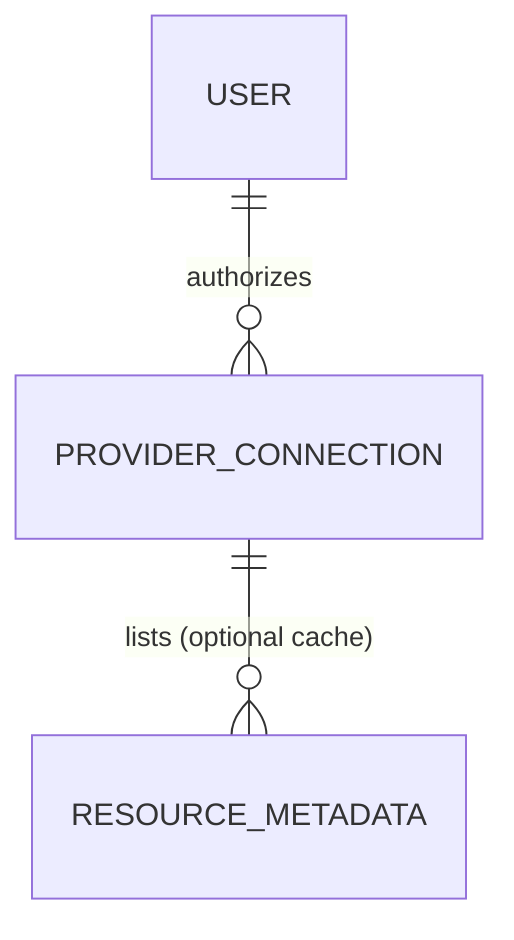

# CRiB Requirements Foundation

## 1. Purpose and status

**CRiB (Cloud Resource Integration Bridge)** is a proposed web application that gives an authenticated user one place to connect a supported cloud-storage account, browse its resources, and download an eligible file through the provider.

This is the requirements baseline. It is deliberately lightweight: it supports a credible Penpot prototype, an architecture diagram, and a build-ready backlog without pretending that every later implementation choice has already been made.

**Status:** working baseline for team review. Decisions marked `Pending` in Section 4 need confirmation before becoming a build commitment.

## 2. Assessment alignment

| Assessment need                        | Type      | Format                           | Evidence to prepare in the prototype phase                                                                                                 | Location        |
| -------------------------------------- | --------- | -------------------------------- | ------------------------------------------------------------------------------------------------------------------------------------------ | --------------- |
| Detailed interactive prototype         | Mandatory | Clickable Penpot prototype + URL | Clickable flow for the primary user journey, with desktop and responsive states where practical. Shareable link with view permissions checked in a private/incognito browser. | Penpot URL:     |
| Documentation with images and comments | Preferred | PDF (from Markdown and Penpot)   | Exported prototype PDF that captions key screens and notes known limitations/decisions.                                                    | Repository URL: |
| Clear, simple documentation            | Mandatory | Markdown and/or diagrams, images | This requirements baseline, architecture diagram, decision log, and a short implementation plan in the repository.                         |                 |

## 3. Product scope

### 3.1 Problem statement

People may keep files across separate cloud-storage services. Switching between provider interfaces makes it harder to locate, understand and use their resources. CRiB will demonstrate a secure aggregation layer: users authorize CRiB to access a supported provider and then browse a normalized view of the permitted resources.

### 3.2 Prototype and MVP boundary

The prototype must show the intended end-to-end experience. It does **not** need to be a production implementation or prove every integration.

The later MVP (target demo: **1 December**) should prove one real provider integration or, if that risk cannot be retired in time, explicitly demonstrate a mock-provider implementation with a documented provider adapter and test data. A real-provider OAuth spike should happen early enough to avoid making the fallback a late surprise.

### 3.3 In scope for the core MVP

- Account registration, login, logout, and basic user-scoped access.
- One supported cloud-storage provider.
- Provider connection status and an authorization/connection flow.
- File and folder listing, folder navigation, common metadata, search, and basic filtering.
- Clearly attributable provider source for each resource.
- Controlled download of a selected resource when permitted by the provider (no in-app content preview).
- Responsive, accessible core UI; useful errors and empty states.
- A public deployment, appropriate test coverage, and concise project documentation.

### 3.4 Explicitly out of scope for the core MVP

Listing exclusions keeps the MVP boundary visible to the team and the assessor, and gives a reference when a new idea comes up.

- Full or scheduled synchronization, backup, mirroring, or offline caching.
- Copying all provider files into CRiB-managed storage.
- A local-device/USB/NAS agent, remote local-filesystem control, or physical-device transfer.
- Multiple providers before the first provider works end to end.
- File sharing, duplicate detection, analytics beyond a small summary, and advanced previews.
- MFA, social login, email verification, and password recovery unless the team selects and validates them without displacing core delivery.

## 4. Working decisions

Each decision records the agreed position, its status, and the owning area. `Decided` items are part of the baseline; `Pending` items close at the stated point.

| ID   | Topic                     | Decision                                                                                                                                                                  | Status                              | Owner                |
| ---- | ------------------------- | ------------------------------------------------------------------------------------------------------------------------------------------------------------------------- | ----------------------------------- | -------------------- |
| D-01 | Aggregation scope         | CRiB aggregates metadata and offers controlled, provider-backed access. Synchronization is a future extension.                                                            | Decided                             | Frontend and Backend |
| D-02 | First provider            | One provider behind a provider-adapter boundary: **Google Drive** (OQ-01).                                                                                               | Decided                             | Backend              |
| D-03 | Real API versus mock      | A mock provider supports early UX and integration work. The demo uses Google Drive if the OAuth spike succeeds; otherwise it shows the mock provider and adapter contract and states the limitation. | Pending: OAuth/resource-list spike | Backend              |
| D-04 | Download versus transfer  | Download only (OQ-05), through a provider-permitted route. No in-app content preview, no transfer to local devices.                                                       | Decided; mechanism pending spike    | Backend              |
| D-05 | Prototype versus demo     | Assessment 1 validates the designed experience (Penpot); Assessment 2 validates the working MVP (1 December).                                                             | Decided                             | Team                 |
| D-06 | Authentication            | Email and password credentials only. Social login, MFA, email verification, and password recovery are outside the MVP.                                                   | Decided                             | Frontend and Backend |
| D-07 | Deployment                | Internet-accessible demo on free/low-cost services with test data only. AWS preferred (OQ-03).                                                                             | Pending: after stack/provider spike | TBD                  |

### 4.1 Ownership areas

Owners are assigned by area while individual roles settle; names can replace areas once the team agrees.

- **Frontend:** screens and templates/components, navigation, form validation messages, empty/loading/error states, responsive layout, accessibility, and alignment with the Penpot prototype.
- **Backend:** authentication and sessions, protected routes, provider integration (OAuth, adapter), data model and database, API endpoints, and security controls.
- **Team:** shared decisions, documentation, testing evidence, and the contribution statement.
- **TBD:** not yet assigned.

## 5. Actors and primary journeys

### Primary actor

**Registered user:** a person with a CRiB account who may authorize one cloud-storage account from the selected supported providers. Future versions may support additional providers and additional accounts.

### Primary journey

1. The user is presented with the landing page, where they learn what CRiB does and how to use it.
2. The user registers or signs in.
3. The user opens an initially empty dashboard and chooses a provider to connect.
4. The user authorizes the selected provider and returns to CRiB dashboard.
5. The user sees connection status and browses folders/resources.
6. The user searches or filters the resource list.
7. The user views a resource's details and initiates an allowed download.
8. The user can disconnect the provider and sign out.

### Prototype screens

- Landing page
- Register / sign in / sign out state
- Empty dashboard with provider connection call to action, empty resource list and disabled actions panel
- Provider-selection and OAuth hand-off/return states
- Connected dashboard with resource list and provider badge
- Folder navigation and resource detail/action state
- Action panel with search, filter, no-results, loading, expired-connection, and error states
- Account details management and connected-provider management

## 6. Functional requirements

Priority uses MoSCoW: **Must**, **Should**, **Could**, **Won't (this release)**. 
- “Prototype” means the interaction must be represented in Penpot; 
- “Demo” means it must be working for the 1 December MVP unless noted.

| ID    | Description                             | Requirement                                                                                                                           | Module            | Priority | Phase                                               | Acceptance criteria                                                                                                                                                                                      |
| ----- | --------------------------------------- | ------------------------------------------------------------------------------------------------------------------------------------- | ----------------- | -------- | --------------------------------------------------- | -------------------------------------------------------------------------------------------------------------------------------------------------------------------------------------------------------- |
| FR-01 | Landing page                            | The system shall present a public landing page explaining CRiB's purpose and the supported-provider concept.                          | Core              | Must     | Prototype, Demo                                     | A first-time visitor can identify the product purpose, main action, and privacy/security expectation without authentication.                                                                             |
| FR-02 | Register/Sign in/Sign out               | The system shall let a new user register and an existing user sign in and sign out using email and password credentials.              | Auth              | Must     | Prototype, Demo                                     | Valid credentials create an authenticated session; invalid credentials show a safe, understandable error; sign-out ends access to protected routes.                                                      |
| FR-03 | Protected routes                        | The system shall prevent an unauthenticated user from viewing dashboard, provider, or resource data.                                  | Auth              | Must     | Prototype, Demo                                     | Direct navigation to a protected route redirects to sign-in or returns an authorized error response.                                                                                                     |
| FR-04 | Dashboard                               | The system shall show an authenticated user a dashboard with connected-provider status and a clear way to connect the first provider. | Core/Auth         | Must     | Prototype, Demo                                     | A user with no connection sees an empty state and connect action; a connected user sees provider name and status.                                                                                        |
| FR-05 | Connect provider                        | The system shall let a user start authorization for one selected cloud-storage provider using the provider-supported mechanism.       | Provider          | Must     | Prototype, Demo / mock permitted during early build | The user can initiate a connection; the application does not request or store the provider password.                                                                                                     |
| FR-06 | Connection ownership                    | The system shall record a provider connection only for the authenticated user who authorized it.                                      | Provider          | Must     | Demo                                                | A user can see and use only their own provider connections; a second user cannot retrieve or alter them.                                                                                                 |
| FR-07 | Dashboard resource list                 | The system shall show connected resources as a list with at least name, resource type, provider, and modified date when available.    | Core              | Must     | Prototype, Demo                                     | The list distinguishes provider/source and handles unavailable metadata without breaking the screen. Unavailable data defaults to placeholder display-only values.                                       |
| FR-08 | Resource list provider folder structure | The system shall allow navigation into and out of folders where the provider supports folders.                                        | Core              | Could    | Prototype, Demo                                     | Provided the cloud metadata received allows this behavior the application could replicate folder structure. Selecting a folder updates the displayed contents and exposes a clear route/breadcrumb back. |
| FR-09 | Search list                             | The system shall let a user search the currently available resource set by name.                                                      | Search and Filter | Must     | Prototype, Demo                                     | A search term visibly narrows matching results; empty results have a clear state and reset action.                                                                                                       |
| FR-10 | Filter list                             | The system shall let a user apply at least one simple resource filter, such as type.                                                  | Search and Filter | Should   | Prototype, Demo                                     | Applying/removing a filter changes the shown resources and makes the active filter visible.                                                                                                              |
| FR-11 | Download resources                      | The system shall let a user download an eligible selected resource using a provider-permitted route.                                  | Provider          | Must     | Prototype, Demo where provider permits              | The action is only available for eligible resources, disabled for the rest; failures show a useful error and do not expose another user's resource.                                                      |
| FR-12 | Notification of expired connection      | The system shall warn a user when a connection has expired or failed and provide a reauthorization/retry action.                      | Provider          | Should   | Prototype, Demo if real provider                    | An expired/failed connection has a clear status, does not silently show stale authority, and offers the next step.                                                                                       |
| FR-13 | Provider connection management          | The system shall let a user view and disconnect their own provider connection.                                                        | Core/Provider     | Should   | Prototype, Demo                                     | Disconnect requires confirmation, removes/revokes local usable connection state as applicable, and updates the dashboard.                                                                                |
| FR-14 | Error notification                      | The system shall provide loading, empty, permission-denied, and service-error states for the main connection and browsing flow.       | Core              | Must     | Prototype, Demo                                     | Each specified state is designed and can be reached or demonstrated; messages do not reveal secrets or implementation internals.                                                                         |
| FR-15 | User session                            | The system may remember a user's last list/display preference after a deliberate selection.                                           | Core              | Could    | Prototype, Demo only if time permits                | Session cookie or similar mechanism to persist a changed preference for the same authenticated user and can be changed again.                                                                            |

**Protected and public routes (FR-03, NFR-02)**

- **Public:** landing page, register, and sign in.
- **Protected:** every page or API endpoint that shows or changes user-specific data: dashboard, provider connection and management, resource list, folder navigation, resource details, download, and account settings. A protected route requires a valid session and checks that the requested connection or resource belongs to that user.
- **Provider callback:** the OAuth return route is reachable from the provider, but only completes a connection for the signed-in user who started it (validated state parameter).

## 7. Non-functional requirements

| ID     | Description                         | Requirement                                                                                                                                     | Module              | Priority    | Phase           | Acceptance criteria / measure                                                                                                                                                                                   |
| ------ | ----------------------------------- | ----------------------------------------------------------------------------------------------------------------------------------------------- | ------------------- | ----------- | --------------- | --------------------------------------------------------------------------------------------------------------------------------------------------------------------------------------------------------------- |
| NFR-01 | **Security - authentication**       | Passwords, if used, shall never be stored in plaintext; authenticated session material shall be protected.                                      | Auth                | Must        | Prototype, Demo | Implementation review verifies a proven password-hashing library and that no plaintext passwords are stored or logged. No secrets in source, logs, or database fixtures; secrets live in environment configuration or secure storage. |
| NFR-02 | **Security - authorization**        | Every protected API/resource action shall verify the authenticated user and ownership of the provider connection/resource.                      | Auth                | Must        | Prototype, Demo | A negative integration test proves that User B cannot access a connection or resource requested with User A's identifier.                                                                                       |
| NFR-03 | **Security - provider credentials** | CRiB shall use the provider-supported authorization flow and shall not collect provider passwords.                                              | Auth                | Must        | Demo            | Connection UI redirects/uses the provider authorization flow; review confirms minimum required scopes and protected token handling.                                                                             |
| NFR-04 | **Security - common web risks**     | Inputs shall be validated, database access shall be parameterized/ORM-backed, and errors shall not expose stack traces or secrets to end users. | Auth                | Must        | Demo            | Tests or review cover invalid input and unsafe access attempts; deployed error response is safe and understandable.                                                                                             |
| NFR-05 | **Privacy**                         | The app shall minimize retained provider data and avoid storing file content unless explicitly required for a demonstrated feature.             | Core                | Must        | Demo            | Data model documents the purpose of each stored field; no bulk file-copy feature is implemented in the MVP.                                                                                                     |
| NFR-06 | **Usability**                       | The primary journey shall be understandable without team assistance.                                                                            | Core                | Must        | Prototype, Demo | At least two independent test users can complete sign-in, connection (or mock connection), browsing, search, and resource action; findings are recorded.                                                        |
| NFR-07 | **Accessibility**                   | The core UI shall support keyboard navigation, visible focus, semantic labels, sufficient colour contrast, and non-colour-only status cues.     | Core                | Should      | Demo            | Manual keyboard pass and automated/lint audit find no critical issues in the primary flow; design includes labels/error text.                                                                                   |
| NFR-08 | **Responsive behaviour**            | Core screens shall work from a narrow mobile viewport through desktop.                                                                          | Core                | Should      | Prototype, Demo | Prototype shows mobile and desktop variants for dashboard and resource browser; implementation has no horizontal overflow in the primary flow.                                                                  |
| NFR-09 | **Performance**                     | The resource list shall avoid loading an unbounded remote collection in one request.                                                            | Core/Provider       | Should      | Demo            | The design/API documents paging or a bounded result size; a normal test-data list becomes usable within an agreed demo target.                                                                                  |
| NFR-10 | **Reliability**                     | Provider/API failures and missing metadata shall degrade gracefully.                                                                            | Core/Provider       | Must        | Demo            | A simulated provider error and an empty/partial response result in a recoverable UI state rather than a broken page.                                                                                            |
| NFR-11 | **Maintainability**                 | Provider-specific code shall be isolated behind an adapter/service boundary with documented common resource fields.                             | Provider            | Should      | Demo            | A mock provider and selected real-provider adapter can both satisfy the same documented interface without changing core browsing logic.                                                                         |
| NFR-12 | **Testability and delivery**        | The project shall have repeatable build/test instructions and a lightweight automated check on pull requests.                                   | Core                | Should      | Demo            | Repository README documents local start/test steps; pull request workflow runs at least lint/build and selected tests.                                                                                          |
| NFR-13 | **Cost control**                    | The deployed solution shall use free/low-cost tiers where practicable and avoid storing user files by default.                                  | Architecture/DevOps | Must        | Demo            | TBD - Hosting decision records expected free-tier limits and an owner checks any billing safeguards/usage limits.                                                                                               |


## 8. Data and integration baseline

The initial normalized resource view should use only fields that the chosen provider can reasonably supply:

```dirtree
- Resource
	- id                  # CRiB identifier where needed
	- provider
	- providerResourceId
	- name
	- kind                # file or folder
	- mimeType            # optional
	- size                # optional
	- createdAt           # optional
	- modifiedAt          # optional
	- parentId            # optional
	- accessAction        # allowed / unavailable, not a stored secret
```

Minimum persisted concepts: `user`, `provider_connection`, and (only if needed) sanitized/cached `resource metadata`. Access and refresh tokens are sensitive data; their storage approach must be decided before real-provider deployment.

### 8.1 User, connection, and resource relationship (proposal)

> **Proposal, not a fixed schema.** The ownership chain and the fields tied to a requirement (NFR-01 to NFR-03, NFR-05, FR-06, FR-12) are the intended baseline. Resource fields reflect common provider metadata and the remaining fields are suggestions marked *(optional)*. Field names, types, and the need for a metadata cache are confirmed after the stack decision and the OAuth/resource-list spike (D-03).

Ownership always flows from the user through the provider connection. A resource is never looked up by its own identifier alone; it is reached through a connection that belongs to the signed-in user (NFR-02).



| Entity                | Key fields                                                                                                                                                                                             | Notes                                                                                                   |
| --------------------- | ------------------------------------------------------------------------------------------------------------------------------------------------------------------------------------------------------ | ------------------------------------------------------------------------------------------------------- |
| `user`                | `id` (PK), `email` (unique), `password_hash`, `display_name` *(optional)*, `created_at`, `last_login_at` *(optional)*                                                                                                  | No plaintext password (NFR-01).                                                                         |
| `provider_connection` | `id` (PK), `user_id` (FK → user), `provider`, `provider_account_label` *(optional)*, `status` (connected / expired / revoked / error), `scopes`, `access_token` (encrypted), `refresh_token` (encrypted), `token_expires_at`, `connected_at`, `last_synced_at` *(optional)* | Unique (`user_id`, `provider`) enforces one account per provider in the MVP. Tokens are protected per NFR-03. |
| `resource_metadata`   | `id` (PK), `connection_id` (FK → provider_connection), `provider_resource_id`, `parent_provider_resource_id`, `name`, `kind`, `mime_type`, `size`, `created_at`, `modified_at`, `fetched_at`             | Optional table, only if caching is needed (NFR-05, NFR-09). Unique (`connection_id`, `provider_resource_id`). No file content. |

Deleting or revoking a connection removes its cached metadata (FR-13).


## 9. Risks and open questions

### Risks

| ID   | Risk                                                                                                                                                             | Mitigation                                                                                                   | Owner   |
| ---- | ---------------------------------------------------------------------------------------------------------------------------------------------------------------- | ------------------------------------------------------------------------------------------------------------ | ------- |
| R-01 | Google's OAuth path for an unverified student app may limit access to registered test users, show warning screens, or restrict broad Drive scopes.               | Register team test accounts early, request the narrowest read-only scopes, and confirm in the OAuth spike (D-03). | Backend |
| R-02 | Real personal files could be exposed during development or the demo.                                                                                              | Use dedicated test Google accounts with sample files only.                                                   | Team    |
| R-03 | "Free tier" hosting can still incur charges or hit limits.                                                                                                        | Record the expected limits in the hosting decision and set billing alerts or usage caps (NFR-13).            | TBD     |

### Open questions to close

| ID    | Question                                                                                        | Why it matters                                                                       | Target decision point                                                                      | Module       | Decision                                  | Owner                |
| ----- | ----------------------------------------------------------------------------------------------- | ------------------------------------------------------------------------------------ | ------------------------------------------------------------------------------------------ | ------------ | ----------------------------------------- | -------------------- |
| OQ-01 | Which one provider is first: Google Drive, OneDrive, or Dropbox?                                | Determines OAuth, API model, test accounts, Penpot wording, and the technical spike. | Before implementation planning.                                                            | Provider     | Google Drive                              | Backend              |
| OQ-02 | Is user email verification required for assessment, or only desirable?                          | Changes identity flow and delivery risk.                                             | Before auth build.                                                                         | Core/Auth    | Desirable                                 | Backend              |
| OQ-03 | Which deployment option can host the chosen backend/database inside the cost constraint?        | Affects stack feasibility and public-demo reliability.                               | After the stack/provider spike.                                                            | Architecture | TBD - AWS preferred                       | Frontend and Backend |
| OQ-04 | Does the assessment require named team contribution evidence or a specific presentation format? | Affects GitHub workflow and final artefact structure.                                | As soon as teaching guidance is available. Provided via "Contribution Statement" document. | Core         | To be completed at every assessment stage | Team                 |
| OQ-05 | Is download enough for the demo, or must CRiB preview file content?                             | Prevents an unbounded preview/streaming feature from entering scope.                 | Before finalising demo acceptance tests.                                                   | Core         | Download only                             | Team                 |

## 10. Traceability tips

These are recommended habits, not rules. They make it easier to show who did what and why, and they can be adopted gradually as the team gets comfortable.

- Mention requirement IDs (FR, NFR, OQ, D, R) where it helps: Penpot comments, GitHub issues, pull requests, tests, and the demo script.
- When a requirement changes, note what changed, why, when, and who agreed. A line in the decision log is enough.
- Before promoting a `Should` or `Could` item into the demo, check with the team and agree what it might displace.
- Keep a short decision log next to this document for provider, stack, hosting, and security-storage decisions.
